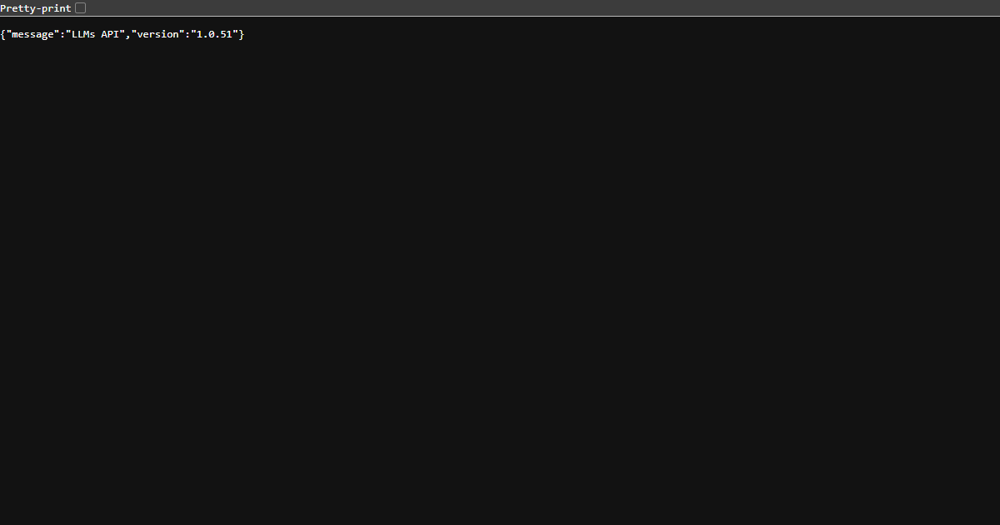

<table width="100%">
  <tr>
    <td align="center" width="120">
      
    </td>
    <td align="right">
      <h1>A Major</h1>
      <h3 style="margin-top: -10px;">The foundation for AI agents. A software company for the agent era.
</h3>
    </td>
  </tr>
</table>



### Local Development

1. Clone the repository

   ```bash
   git clone https://github.com/amajorai/landing.git
   cd landing
   ```

2. Install dependencies

   ```bash
   bun install
   ```

3. Start the development server

   ```bash
   bun dev
   ```

### Content

Blog posts and standalone pages are MDX files managed with [Fumadocs MDX](https://fumadocs.dev/docs/mdx):

- `content/blog/<slug>.mdx` → `/blog/<slug>`
- `content/pages/<slug>.mdx` → `/<slug>` (about, manifesto, privacy, …)

Collections and their frontmatter schemas live in `source.config.ts`; `lib/content.ts` loads them. Blog frontmatter:

```yaml
---
title: "Post title"
description: "Shown in listings, search and meta tags."
date: 2026-10-13 # posts dated in the future stay hidden until that day
authors:
  - jiaweing # keys of `authors` in lib/content.ts
tags:
  - "Guides"
draft: false # true hides the entry everywhere
---
```

Use `<Callout icon="💡">…</Callout>` for callouts. Static files (author avatars, images) go in `public/`.

